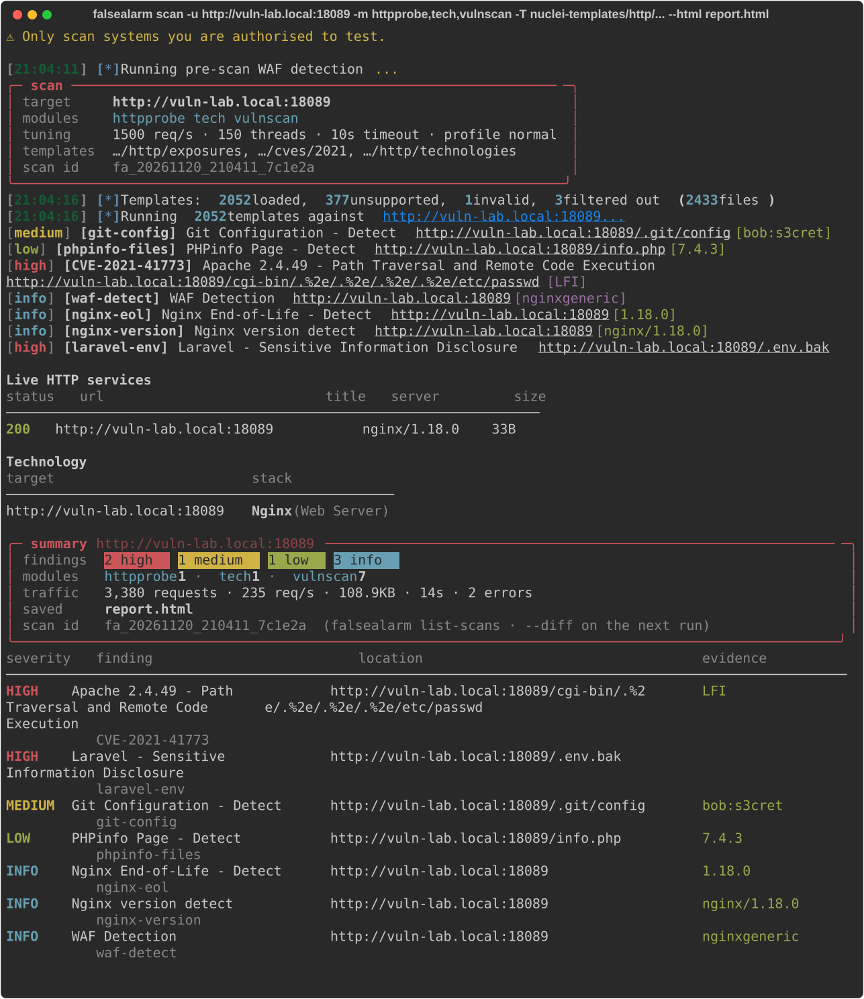
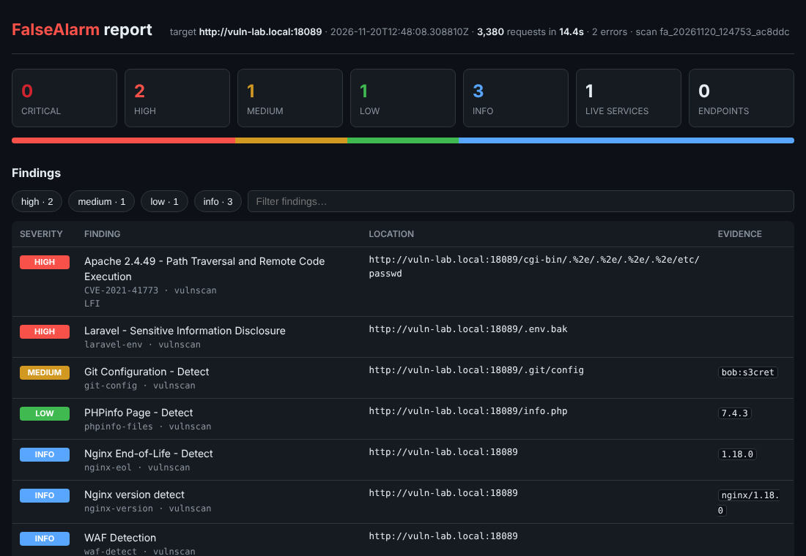

<div align="center">
  <picture>
    <source srcset="assets/Falsealarm.png" media="(prefers-color-scheme: dark)">
    <source srcset="assets/Falsealarm.png" media="(prefers-color-scheme: light)">
    
  </picture>

  <br/>
  <h1>FalseAlarm: Advanced Async Web Reconnaissance Framework</h1>
  <p><strong>An out-of-the-box, Polyglot (Python + Go) & AI-Ready Attack Surface Mapping Engine.</strong></p>

  <p>
    <a href="https://pypi.org/project/falsealarm/"></a>
    <a href="https://pypi.org/project/falsealarm/"></a>
    <a href="https://github.com/reikageisme/falsealarm/blob/main/LICENSE"></a>
    <a href="https://github.com/reikageisme/falsealarm/stargazers"></a>
    <a href="https://github.com/reikageisme/falsealarm/network/members"></a>
    <a href="https://github.com/reikageisme/falsealarm/issues"></a>
    
    
  </p>

  <p>
    <em>Developed by <a href="https://github.com/reikageisme">ReiKage (reikageisme)</a> & The Open Source InfoSec Community.</em>
  </p>

  <a href="#philosophy--the-problem-it-solves">Philosophy</a> •
  <a href="#quickstart">Quickstart</a> •
  <a href="#core-features">Features</a> •
  <a href="#module-ecosystem">Modules</a> •
  <a href="#installation">Installation</a> •
  <a href="#environment-variables">Environment</a> •
  <a href="#usage-guide">Usage Guide</a> •
  <a href="#ai-triage-integration">AI Triage</a> •
  <a href="#contributing">Contributing</a> •
  <a href="CHANGELOG.md">Changelog</a> •
  <a href="#license">License</a>
</div>

---

## Philosophy & The Problem It Solves

Traditional scanning tools are inherently flawed for modern web architectures. They operate synchronously, consume excessive memory, and lack the heuristic intelligence required to bypass Next-Gen Web Application Firewalls (WAFs). 

FalseAlarm was engineered from the ground up to solve this. By combining a Python `asyncio` orchestrator with a high-performance Go (`fasthttp`) worker engine, dynamic YAML vulnerability templates, and intelligent plugin auto-discovery, FalseAlarm allows operators to map vast attack surfaces at blistering speeds with streaming real-time NDJSON feedback.

Accordingly, Human-In-The-Loop (HITL) control is a core design principle of FalseAlarm. Operators retain granular control during execution with non-destructive graceful handling across all async subprocesses via `Ctrl+C` interrupt handlers.

---

## Quickstart

```bash
pipx install falsealarm
falsealarm templates update          # one-time: community nuclei templates
falsealarm scan -u https://target.example -T ~/.falsealarm/nuclei-templates/http \
  --tags cve,exposure --html report.html
```

<p align="center">
  
</p>

While a scan runs, a live status bar shows the current module, a progress bar
(e.g. `1,129/2,052 templates`), live req/s, HTTP status mix and findings by
severity. Findings print the moment they are confirmed; the run ends with a
summary panel and a severity-sorted findings table. Without a TTY (CI, `> log`)
or with `--no-progress`, output is a plain scrolling log with no ANSI codes.

<p align="center">
  
</p>

`--html report.html` writes a single self-contained file (no external assets,
works offline, attacker-controlled values escaped, strict CSP) that you can
attach to a ticket or send to a client.

---

## Environment Variables

For leveraging private AI triage models and custom API endpoints, FalseAlarm automatically reads your configuration from `.env`. Create or update your `.env` file in the project root:

```bash
# Create local .env file
cat << 'EOF' > .env
GEMINI_API_KEY="your_google_gemini_api_key_here"
GEMINI_MODEL="gemini-3.1-pro-preview"   # optional, this is the default
OPENAI_API_KEY="your_openai_api_key_here"
ANTHROPIC_API_KEY="your_anthropic_api_key_here"
EOF
```

---

## Core Features

### Polyglot & High-Performance Engine
* **Python Orchestrator + Native Go Engine:** High-speed directory and parameter fuzzing powered by `fasthttp` in Go, with real-time NDJSON line-by-line streaming.
* **Full Asynchronous I/O:** Built on `aiohttp` and `asyncio`, capable of sustaining thousands of concurrent connections with minimal CPU footprint.
* **Token Bucket Rate Limiting:** Millisecond-precision traffic control with automatic HTTP 429 backoff handling.
* **Auto-Discovery Plugin Architecture:** Drop any custom `.py` module inheriting `BaseModule` into `falsealarm/modules/` for instant execution without touching core code.

### Stealth & Evasion
* **Proxy Orchestration:** Native support for chained HTTP and SOCKS5 proxies (e.g., Tor network) with automatic node health checks.
* **Dynamic Fingerprinting:** Automated rotation of `User-Agent` and HTTP headers (Accept, Accept-Language, Accept-Encoding) to blend into legitimate traffic profiles. The Go fuzzing engine now honours the same proxy, rate limit, and User-Agent as the Python core.
* **Smart Catch-All & Baseline Calibration:** Heuristic analysis to calculate response baselines, filtering out wildcard DNS and soft-404 traps.

> **Injection family:** `sqli`, `nosqli` and `ssti` share one framework —
> they enumerate URL/query parameters and HTML form fields (GET and POST,
> login forms included), inject per-engine payloads, and **re-verify every
> candidate** before reporting. They are *detectors*: hand confirmed findings
> to `sqlmap` / `tplmap` for exploitation.

### Authenticated & Scoped Scanning
* **Authenticated scans:** pass `-H "Authorization: Bearer …"` (repeatable) and/or `-b "session=…"`; every request in every module stays authenticated.
* **Scope guard:** `--scope example.com,*.example.com,10.0.0.0/8` keeps the scan — including auto-discovered subdomains, redirects and JS endpoints — inside the authorised scope; `--exclude-scope` blocks hosts.
* **User defaults:** `falsealarm config init` writes `~/.falsealarm/config.yaml` (rate, headers, scope, templates…), applied to every scan; profiles and CLI flags override it.
* **Parallel targets:** `--parallel N` scans N targets at once; history, `--diff` and `--resume` share one home database no matter the working directory.

### Out-of-Band Testing (interactsh / OAST)
`vulnscan` can run nuclei's blind SSRF/RCE/XXE templates that rely on an
out-of-band callback (`{{interactsh-url}}`). With `--oast`, FalseAlarm
registers with a public interactsh server (or your own via `--oast-server`),
substitutes callback hostnames, and reports a finding only when the target
actually calls back (DNS/HTTP). This turns ~430 otherwise-skipped templates
into runnable checks.

```bash
pip install 'falsealarm[oast]'          # adds the cryptography dependency
falsealarm scan -u https://target -m vulnscan -T ~/.falsealarm/nuclei-templates/http \
  --tags ssrf,rce --oast
# self-hosted interactsh:
falsealarm scan -u https://target -m vulnscan --oast --oast-server oast.mydomain.com --oast-token "$TOKEN"
```

### SQL / NoSQL / Template Injection & Login Bypass
* **Four techniques:** error-based (DBMS error signatures), boolean-based blind (response-similarity), time-based blind (with a second confirmation probe to rule out slow apps), and classic authentication bypass on login forms.
* **Finds parameters for you:** URL query parameters and HTML form fields (GET and POST), including login forms.
* **Low false positives:** every candidate is re-verified before it becomes a finding. It is a *detector*, not a dumper — hand confirmed findings to `sqlmap` for extraction.

```bash
# Probe a parameter and any forms on the page (error + boolean by default)
falsealarm scan -u "https://app.example.com/item?id=1" -m sqli

# Add time-based blind (slower) and raise the delay
falsealarm scan -u "https://app.example.com/search?q=x" -m sqli --sqli-technique error,boolean,time --sqli-delay 8

# Test a login form for ' OR '1'='1 auth bypass
falsealarm scan -u "https://app.example.com/login" -m sqli
```

### Reporting & CI
* **Live terminal dashboard:** progress, real-time req/s, status-code mix and findings by severity; nuclei-style one-line findings you can copy straight into a report.
* **Shareable HTML report** (`--html`), Markdown handoff (`--report`), SARIF for GitHub code scanning, JSON/JSONL/CSV.
* **CI gate:** `--fail-on high` exits with code `2` when a finding at or above that severity is found.
* **Unix-friendly:** `--pipe` streams NDJSON on stdout (logs on stderr); honours `NO_COLOR` / `FORCE_COLOR`.

### Intelligence & State Management
* **Multi-Target & CIDR Support:** Scan individual URLs (`-u`), input lists (`-iL targets.txt`), or full IP network blocks (`192.168.1.0/24`).
* **YAML Configuration Profiles:** Save and reuse scan presets (`falsealarm scan -c profile.yaml -p stealth`).
* **AI-Ready Triage:** Direct integration with LLMs (Gemini / Anthropic / OpenAI) to automatically parse scan results and prioritize high-impact vulnerabilities.
* **SQLite State Tracking:** Non-blocking WAL-mode SQLite database with automatic retry timeouts for scan history and state persistence.
* **Bundled AI Agent Skill:** Install maintained FalseAlarm operating and development guidance for Codex, Claude, or a project-local agent.

---

## Module Ecosystem

FalseAlarm's architecture is strictly modular with dynamic plugin discovery. Each component can run in isolation or orchestrated together via the `-A` (All) flag.

| Module Core | Tactical Capability | OPSEC Level | Status |
|-------------|---------------------|-------------|:------:|
| `dns` | Deep Record Enumeration (A, AAAA, MX, NS, TXT, SOA, AXFR, SPF, DMARC) | Passive/Active | Production |
| `subdomain` | Subdomain Enumeration via crt.sh (OSINT) + DNS brute-force with wildcard filtering | Active | Production |
| `httpprobe` | Liveness Probing + Similarity Hashing for false positive reduction | Active | Production |
| `tech` | Fingerprinting (CMS, Frameworks, WAF, CDN) via Headers & DOM | Active | Production |
| `dirfuzz` | Polyglot (Go + Python) High-Speed Path/Directory Fuzzing (NDJSON Streaming) | Aggressive | Production |
| `js_analysis` | JavaScript scanning for hidden API endpoints & hardcoded secrets (same-origin by default) | Active | Production |
| `cors` | Strict CORS Misconfiguration Analysis & Exploit Verification | Active | Production |
| `portscan` | Async TCP/UDP Port Scanner (Nmap alternative for L7 chains) | Aggressive | Production |
| `websocket` | WebSocket (WS/WSS) Discovery & Message Fuzzing | Active | Production |
| `vulnscan` | **Nuclei-compatible** template scanner — runs the community `nuclei-templates` (≈9k HTTP templates) plus bundled checks | Aggressive | Production |
| `favicon` | Favicon hashing (Shodan `mmh3` + `sha256`) for asset pivoting | Active | Production |
| `graphql` | GraphQL endpoint discovery & introspection-exposure check | Active | Production |
| `openredirect` | Open-redirect probing across common redirect parameters | Active | Production |
| `sqli` | SQL injection detection — error / boolean / time-based + **login auth-bypass** (`' OR '1'='1`), every hit re-verified | Aggressive | Production |
| `ssti` | Server-side template injection — arithmetic evaluation across Jinja2/Twig/Freemarker/ERB/Velocity/…, double-confirmed | Aggressive | Production |
| `nosqli` | NoSQL injection — MongoDB operator injection (`[$ne]`), `$where` JS boolean, error-based, and **login auth-bypass** | Aggressive | Production |

---

## Installation

> **TL;DR:** `pipx install falsealarm` and you are scanning in under a minute.
> The Go engine auto-downloads on first use — no Go toolchain required.

### Option 1 — From PyPI (recommended)

```bash
pip install falsealarm==1.0.6
falsealarm scan -u example.com -q
```

Optional AI-agent skill installation:

```bash
# Codex user skill (default)
falsealarm install-skill --target codex

# Other supported destinations
falsealarm install-skill --target claude
falsealarm install-skill --target project
```

The skill is bundled in the Python package, but installation into an agent's
home or project directory is explicit. Use `--force` to update an existing
copy, or `--destination <path>` for a custom final skill directory.

On Debian / Kali / Ubuntu, PEP 668 blocks a system-wide `pip install`
(`externally-managed-environment`). Use **pipx** (best for a CLI tool) or a
virtual environment:

```bash
# pipx keeps FalseAlarm in its own isolated environment
pipx install falsealarm

# ...or a plain venv
python3 -m venv .venv && source .venv/bin/activate && pip install falsealarm
```

Optional Shodan-compatible favicon hashing:

```bash
pipx install "falsealarm[favicon]"
```

> On first run the high-speed Go fuzzing engine auto-downloads a prebuilt
> binary from the latest [GitHub Release](https://github.com/reikageisme/falsealarm/releases).
> If none is available it falls back gracefully to the pure-Python fuzzing
> engine, so FalseAlarm always works out of the box.

### Option 2 — From source (for development)

```bash
git clone https://github.com/reikageisme/falsealarm.git
cd falsealarm
python3 -m venv .venv
source .venv/bin/activate
pip install -e .

# Optionally compile the Go fuzzing engine locally (else it is auto-fetched)
python -m falsealarm build-engine
```

### Option 3 — Docker

The Dockerfile compiles the Go engine during the build automatically.

```bash
git clone https://github.com/reikageisme/falsealarm.git
cd falsealarm
docker build -t reikageisme/falsealarm .
docker run -it --rm reikageisme/falsealarm scan -u example.com -A
```

---

## Usage Guide

The FalseAlarm CLI is built for speed and intuition.

### Pre-Pentest Workflow

FalseAlarm produces a repeatable attack-surface baseline before manual testing
begins. Start with the least intrusive profile and expand only when the rules
of engagement authorize active enumeration.

```bash
# Fast baseline: live HTTP services and TLS/security-header posture
falsealarm scan -u example.com -q --report quick-baseline.md

# Application mapping: fingerprinting, archived URLs, JavaScript endpoints,
# CORS, WebSockets, directory discovery, and template checks
falsealarm scan -u example.com --depth deep --report attack-surface.md

# Full authorized reconnaissance: DNS, subdomains, ports, and every web module
falsealarm scan -u example.com -A --adaptive-rate --diff \
  -o falsealarm.sarif -f sarif --report pentest-handoff.md
```

The Markdown handoff separates automated evidence from a prioritized manual
testing queue. A clean automated scan is not evidence that an application is
secure; authorization, session, business-logic, and authenticated workflows
still require a human tester and an intercepting proxy.

JavaScript analysis is same-origin by default to keep findings inside scope and
reduce vendor-library noise. Use `--include-third-party-js` only when the rules
of engagement explicitly include external assets or supply-chain review.

### Nuclei Templates

`vulnscan` runs [nuclei](https://github.com/projectdiscovery/nuclei-templates)
HTTP templates directly: `path`/`raw` requests, payloads (batteringram,
pitchfork, clusterbomb), multi-step requests with dynamic extractors, and
`word`/`regex`/`status`/`size`/`binary`/`dsl` matchers. Every request still
goes through FalseAlarm's rate limiter, proxies, and adaptive backoff.

```bash
# One-time: fetch the community templates (~/.falsealarm/nuclei-templates)
falsealarm templates update

# See how many of them FalseAlarm can run and why the rest are skipped
falsealarm templates validate ~/.falsealarm/nuclei-templates/http

# Scan with high/critical CVE templates only
falsealarm scan -u https://example.com -m vulnscan \
  -T ~/.falsealarm/nuclei-templates/http --tags cve -s high,critical

# Mix your own templates with the bundled ones
falsealarm scan -u https://example.com -m vulnscan -T ./my-templates,bundled
```

Templates that need features FalseAlarm does not run yet (out-of-band
interactsh callbacks, `flow:` scripting, headless/DNS/TCP protocols) are
**skipped and counted** instead of being run with half the logic, so they can't
produce false positives. `dos` and `fuzz` tagged templates are excluded unless
you request them with `--tags`.

### Standard Reconnaissance
```bash
# 1. Comprehensive mapping (All modules)
falsealarm scan -u example.com -A

# 2. Targeted modular scan (DNS and Tech only)
falsealarm scan -u example.com -m dns,tech

# 3. Multi-target file or CIDR range scan
falsealarm scan -iL targets.txt -q
falsealarm scan -u 192.168.1.0/24 -m portscan,httpprobe

# 4. Quick mode (Bypasses heavy fuzzing for rapid overview)
falsealarm scan -u example.com -q
```

### Stealth & High-Speed Fuzzing
```bash
# Rate limited with Tor network proxy and randomized headers
falsealarm scan -u example.com -A -r 15 -t 20 --proxy socks5://127.0.0.1:9050 --random-agent

# High-intensity Go-accelerated Directory Fuzzing
falsealarm scan -u http://example.com/FUZZ -m dirfuzz -t 100 -w common.txt

# Recursive content discovery (dig into discovered directories)
falsealarm scan -u http://example.com -m dirfuzz --recursion-depth 2
```

### CI/CD Security Gate

```yaml
# .github/workflows/falsealarm.yml
- run: pipx install falsealarm && falsealarm templates update
- run: |
    falsealarm scan -u "$STAGING_URL" -m httpprobe,vulnscan \
      -T ~/.falsealarm/nuclei-templates/http --tags exposure,misconfig \
      -o falsealarm.sarif -f sarif --html falsealarm.html --fail-on high
```

The step fails (exit code `2`) on any high/critical finding; upload the SARIF
file to GitHub code scanning and the HTML file as a build artifact.

### Pipe Mode & Tool Chaining (NDJSON)
FalseAlarm reads targets from stdin and streams NDJSON results to stdout with
`--pipe` (logs go to stderr), so it composes with the rest of your toolkit:

```bash
# Chain FalseAlarm stages together
echo example.com | falsealarm --pipe -m httpprobe | jq -r .url \
  | falsealarm --pipe -m tech,vulnscan

# Feed it from other recon tools
subfinder -d example.com | falsealarm --pipe -m httpprobe -o live.jsonl -f jsonl
```

### Data Management & Profiles
```bash
# Load scan parameters from a YAML profile
falsealarm scan -c profile.yaml -p stealth

# Export results to JSON for CI/CD pipelines
falsealarm scan -u example.com -A -o results.json -f json

# Export SARIF for GitHub Code Scanning and security CI pipelines
falsealarm scan -u example.com -A -o falsealarm.sarif -f sarif

# Produce a pentester handoff with attack surface, priorities, and a manual test queue
falsealarm scan -u example.com -A --report pentest-report.md

# List historical scans
falsealarm list-scans

# Inspect every installed module before choosing a scan profile
falsealarm modules

# Continue a scan that was interrupted or paused
falsealarm scan --resume <scan-id>
```

---

## AI Triage Integration

FalseAlarm introduces an AI Triage layer. By hooking into Gemini / OpenAI / Anthropic LLMs, the framework automatically analyzes scan outputs, filters out noise, and highlights chained exploit paths.

**Execute scan with AI Triage:**
```bash
falsealarm scan -u example.com -A --ai-triage
```

The default triage model is `gemini-3.1-pro-preview`. Override it with the
`GEMINI_MODEL` environment variable — for example `gemini-3.8-flash` for
cheaper, faster triage:

```bash
GEMINI_MODEL=gemini-3.8-flash falsealarm scan -u example.com -A --ai-triage
```

---

## Python API Integration

FalseAlarm is fully extensible. You can import its async core directly into your own security orchestration scripts.

```python
import asyncio
from falsealarm.core.config import ScanConfig
from falsealarm.core.engine import AsyncEngine
from falsealarm.modules.techdetect import TechDetectModule

async def automate_recon():
    # 1. Define scanning parameters
    config = ScanConfig(
        target="example.com",
        modules=["tech"],
        threads=20,
        timeout=10
    )
    
    # 2. Initialize the asynchronous networking core
    engine = AsyncEngine(config)
    
    # 3. Instantiate and execute the specific module
    module = TechDetectModule(config, engine)
    results = await module.run()
    
    print(f"[+] Discovered Technologies: {results}")
    await engine.close()

if __name__ == "__main__":
    asyncio.run(automate_recon())
```

---

## Contributing

We welcome contributions from the InfoSec community. Whether it's adding new YAML vulnerability templates, optimizing the async core, or fixing bugs, please review our [CONTRIBUTING.md](CONTRIBUTING.md) guidelines before submitting a Pull Request.

### Code of Conduct
Please note that this project is released with a Contributor Code of Conduct. By participating in this project you agree to abide by its terms. See [CODE_OF_CONDUCT.md](CODE_OF_CONDUCT.md).

---

## License

Copyright (c) 2026 **ReiKage (`reikageisme`)** & FalseAlarm Security Engine Contributors.

This project is a combination of open-source components under the **MIT License** (see [LICENSE-MIT](LICENSE-MIT)) and framework additions licensed under the **Research & Security Assessment License** (see [LICENSE](LICENSE)).

---

## Legal Disclaimer & Ethics

FalseAlarm is an offensive security tool designed strictly for authorized penetration testing, academic research, and lawful bug bounty programs.

Executing Layer 7 reconnaissance and fuzzing attacks against infrastructure without explicit, written authorization is illegal. The developers assume zero liability for any misuse, damage, or legal consequences resulting from the deployment of this tool.

*Hack ethically. Stay authorized.*
